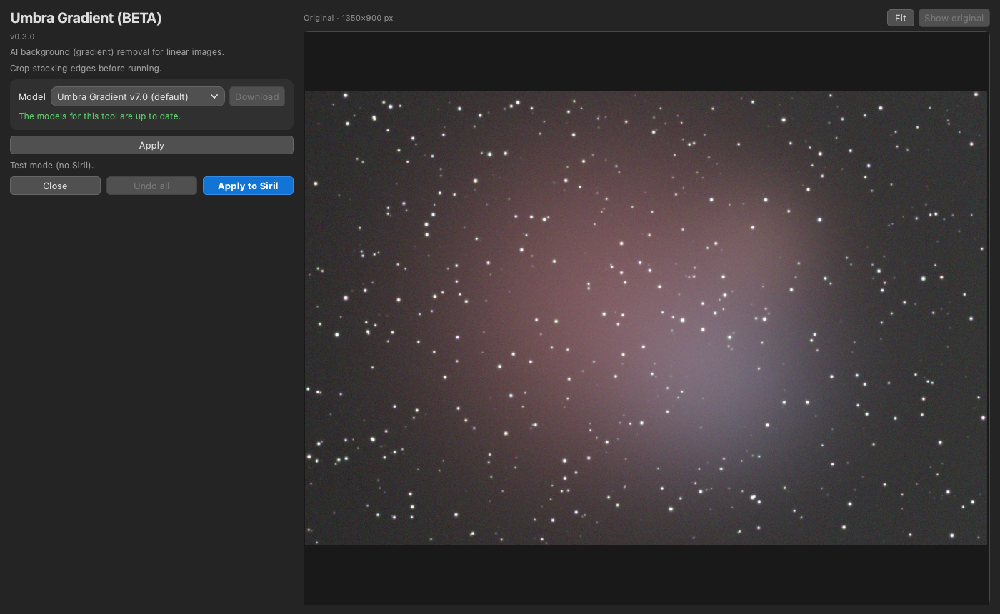
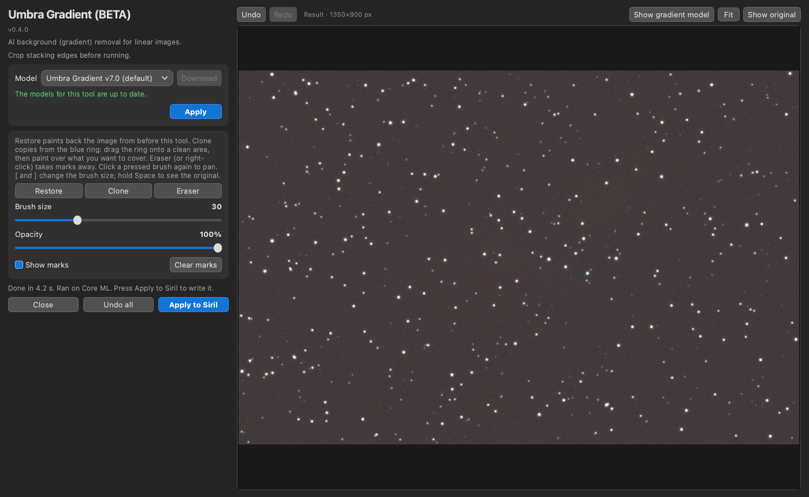
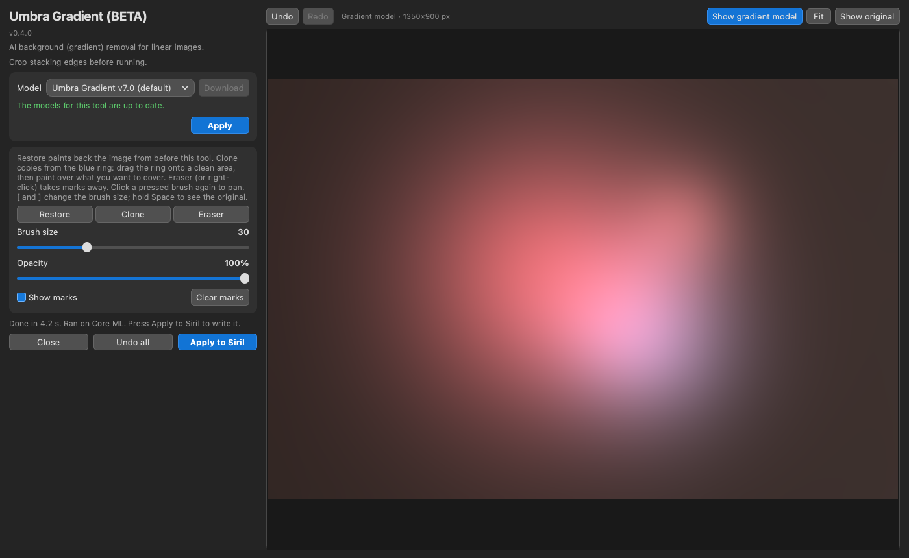

# Umbra Gradient (BETA)

Umbra Gradient is an AI background (gradient) remover for linear images in [Siril](https://siril.org). It is a Siril Python script with an AI model. It runs locally on your computer and is free. It removes sky glow, light pollution and flat-field problems while trying to keep faint nebulosity, dark nebulae and true colour.

**Status: Beta (v0.3.0).** Expect rough edges.

*Screenshots (synthetic test image): the original (Show original held), the result, and the gradient model (Show gradient model).*

## Download and install

1. Download the single file [`Umbra_Gradient.py`](https://raw.githubusercontent.com/Kishanhpatel/umbra-gradient/main/Umbra_Gradient.py) (also attached to the [latest release](https://github.com/Kishanhpatel/umbra-gradient/releases/latest)). Save it in any folder you like. Siril has no standard scripts folder name.
2. In Siril open **Preferences > Scripts**, add that folder, refresh the list, then run **Umbra Gradient** from the Scripts menu.
3. First run: Siril installs the Python packages the script needs (numpy, onnxruntime, PyQt6, scipy, astropy). This can take a few minutes.
4. If no model is installed, the model drop-down lists it as "Umbra Gradient v7.0 (Not Downloaded)". Select it and press **Download**, right of the drop-down (about 112 MB). The file is checked with SHA-256 and saved in a folder named `Umbra Gradient` next to the script.

**Manual install.** Download the `.onnx` file from the [release page](https://github.com/Kishanhpatel/umbra-gradient/releases/latest) and put it in the `Umbra Gradient` folder next to the script. To use another folder, set `UMBRA_GRADIENT_MODEL_DIR` to it. `UMBRA_GRADIENT_MODEL` can point at one specific model file.

**Updates.** Each time the script opens, it checks the published list (`models/models.json`) for a newer script and for new or changed models. A line under the model row shows the result. In green: "The models for this tool are up to date." In yellow: "There is an update to this script available" or "There is a new model available for this tool, select the model in the dropdown and click Download to install." A model downloads only when you press **Download**. A newer script is shown as a link to the release page; the script never replaces itself. Nothing is sent about you or your computer (only a generic client name). With no network the installed models keep working. Set `UMBRA_GRADIENT_OFFLINE=1` (or `UMBRA_OFFLINE=1`) to turn the lookup off.

## What it does

The model looks at the whole image (shrunk to 256 x 256) and predicts a smooth background as a 64 x 64 grid per colour channel. That grid is scaled up and subtracted. Because the background is smooth by construction, it cannot add noise or texture. The median background level of each colour is kept, so the sky keeps its colour balance and colour neutralisation is left to a later step.

**Very bright stars (since v0.2.2).** A very bright star with a huge round glow, such as Alnitak next to the Flame Nebula, used to be read as part of the gradient: its glow was subtracted, leaving a dark hole around the star and a colour cast across the frame. Such glows are now found automatically and left out when the background is modelled (the background is still subtracted everywhere). The Siril log says when this happens and the radius used. Only round, isolated glows count, so bright stars inside bright nebula or galaxies (M42, M16, M31) are handled exactly as before.

There are no sliders and no options. To save the subtracted background as a FITS file, use `--gradient-out` on the command line.

Crop stacking edges before running.

**The window.** The window has a fixed-width controls column on the left and a large image area on the right. The image area shows the current image (auto-stretched) as soon as the window opens. Scroll or pinch to zoom and drag to pan. Double-click the image or press **Fit** to fit the whole image. Hold down **Show original**, or hold the Space key anywhere in the window, to compare with the image before the tool; release it to see the result again. **Undo** and **Redo** at the top left of the image area step back and forward through your Apply results (Cmd/Ctrl+Z and Cmd/Ctrl+Shift+Z); the last 10 steps are kept. The window keeps its size when you switch tools or models.

**Apply and Apply to Siril.** **Apply** (the small blue button inside the tool's panel) runs the model on the whole image (it needs global context) and shows the result in the image area, with the same stretch as the original. The image in Siril is not changed. **Show gradient model** in the image area shows the background that is subtracted. **Apply to Siril** writes the current result to the image in Siril as one step, so Siril's **Undo** goes back. If you changed the settings since **Apply**, it runs the tool first. Until then the image in Siril is not changed, whatever you do in the window. **Undo all** (bottom row, between **Close** and **Apply to Siril**) goes back to the image as it was when the window opened, and also puts it back in Siril if you had written anything; **Redo** can still bring the steps back. Siril's scripting interface cannot write a FITS HISTORY line, so the settings used are written to the Siril log (and into any extra FITS file the tool saves).

**Restore, Clone and Eraser brushes.** A second panel under the tool's settings is greyed out until **Apply** has made a result. Then:
- **Restore**: paint where you want the image from before this tool back (for example where the tool went too far).
- **Clone**: copies from the blue source ring, like the clone tool in Umbra Astro Studio. Drag the ring onto a clean area, then paint over what you want to cover. While you paint, a second ring shows where it is copying from, and the brush shows a preview of the patch.
- **Eraser** (or right-click with any brush): takes Restore and Clone marks away again.
- **Brush size** (keys **[** and **]** make it smaller and bigger), **Opacity**, **Show marks**, **Clear marks**.

Click a pressed brush again to go back to pan and zoom. The result updates after each stroke without running the AI again, and the brushes stay part of the same Apply step (one Undo removes it). Marks are cleared when the image the tool starts from changes.

**Command line.** `python Umbra_Gradient.py --image IN.fits --out OUT.fits` runs the tool without a window. Flags: `--gradient-out FILE`, `--model PATH`. `--check-updates` and `--download [MODEL_ID|all]` work from the command line too, and `--help` lists everything.

## Models

Since v0.2.0 the model files store their weights at half size (16-bit) and compute in full 32-bit precision, so the results are bit-identical to the larger v0.1.x files. If you already have the larger file it keeps working and is not downloaded again.

Models are published as GitHub release assets and are not stored in this repository. See `models/models.json`.

| Name | File | Size | Notes |
|---|---|---|---|
| Umbra Gradient v7.0 (default, only model) | `umbra_gradient_v7.0.onnx` | 112 MB | Trained on synthetic gradients (including soft-edged steps and bands, and star glare) added to real and synthetic scenes. |

## Strengths

- Keeps dark sky, dark nebulae, dust lanes and nebula colour. In our injection tests about 99.9% of added faint nebula was kept.
- Output is a smooth model that is subtracted, so no noise or texture is added.
- Removes soft-edged steps and bands (dew or hood shadows, panel seams, flat stripes) and glare around bright stars, while very bright stars with a huge round glow keep it (v0.2.2). About 8% of an added soft step or band was left (median).
- Works on colour and mono images and on images with NaN or zero stacking borders.
- Fast: a full 6000 x 6000 frame takes a few seconds.

## Weaknesses

- Diagonal bands (for example in some M101 frames) are only partly removed.
- On a few frames that are full of nebula (Horsehead, Tulip, North America, Heart) it removes slightly less of an added gradient than the previous model generation. About 9% of an added gradient was left (median).
- It only models smooth, large-scale gradients. It does not fix small-scale uneven flats.
- Linear data only. It does not neutralise colour: do that afterwards.
- Stacking edges and borders should be cropped first.
- Tested mainly on the author's own data and one Mac.

## GPU acceleration

The GPU is used by default whenever one can be used, and the CPU only as a fallback. Providers are tried in this order: CUDA (NVIDIA), DirectML (Windows), ROCm and MIGraphX (AMD on Linux), OpenVINO (Intel), Core ML (Mac), then CPU. Each one is checked against the CPU result on a small probe tile before it is used; if it fails or the result differs, the script falls back to the CPU. The status line says which one ran ("Ran on ..."). Set `UMBRA_GRADIENT_CPU=1` to force the CPU.

On first run the script installs the onnxruntime package that gives your system a GPU:

- **Mac:** `onnxruntime` (Core ML, Apple GPU, built in).
- **Windows:** `onnxruntime-directml` (any DirectX 12 GPU: NVIDIA, AMD or Intel; no extra downloads).
- **Linux with an NVIDIA GPU:** `onnxruntime-gpu` (CUDA). If the system has no CUDA 12 / cuDNN 9 libraries, NVIDIA's own pip packages of them are installed too (a one-time download of about 2 to 3 GB).
- **Linux with AMD or Intel graphics:** there is no GPU build that installs automatically, so these run on the CPU. If you install `onnxruntime-rocm`, `onnxruntime-migraphx` or `onnxruntime-openvino` yourself in Siril's Python, the script uses it.

## Testing

Be aware of what has and has not been tried. This is a beta.

Tested:
- macOS 26 on an Apple M3, with Core ML and with the CPU.
- Standalone (command line and window test) and inside Siril 1.4.5 run headless (`siril-cli` with `pyscript`): read the image, process it, write it back with an Undo state, save.
- The window was tested offscreen only.
- v0.4.0: the shared history (Apply, Undo, Redo, Apply to Siril, Undo all), the brushes (including Clone) and the Space / [ ] keys were tested offscreen with a stand-in for Siril and synthetic mouse drags, not yet in the Siril window itself.

NOT tested:
- Windows and Linux.
- CUDA, DirectML and ROCm (the code is written; please report what you see).
- Intel Macs.
- The interactive window inside the Siril GUI.

Parity with the original PyTorch version (measured with the v0.2.2 bright-star handling and median level switched off, which is how the PyTorch version worked): the corrected image differs by at most 0.002 noise sigma at a pixel and about 1e-5 sigma rms on every case (four real full frames up to 3840 x 2160, a 2048 px crop with saturated stars, a 6016 x 6016 full frame, mono, a 300 x 250 crop, and a frame with a NaN hole), and the background model by less than 1e-6 of its level. Core ML and CPU agree. A 300 x 250 crop matched the same way, because the model always sees the whole image shrunk to 256 x 256.

## Layout

- `Umbra_Gradient.py`: the script (v0.3.0, ONNX Runtime, with model download and update check)
- `models/models.json`: model manifest (name, version, download URL, SHA-256, size)
- `docs/screenshots/`: window screenshots
- `LICENSE`, `LICENSE-MODELS.md`: licenses

## Contact

Bugs or questions: umbraastrolabs@gmail.com, or open an issue on GitHub.

## License

- Script: GPL-3.0-only (see `LICENSE`).
- Models: CC BY-NC-SA 4.0, non-commercial (see `LICENSE-MODELS.md`).
