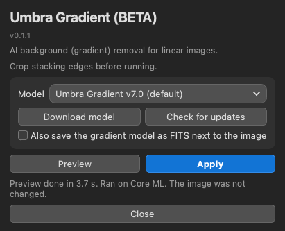
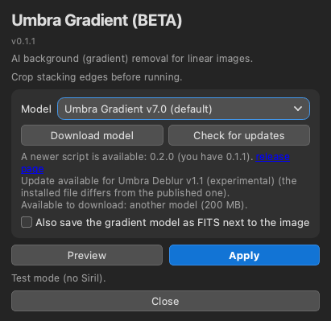

# Umbra Gradient (BETA)

Umbra Gradient is an AI background (gradient) remover for linear images in [Siril](https://siril.org). It is a Siril Python script with an AI model. It runs locally on your computer and is free. It removes sky glow, light pollution and flat-field problems while trying to keep faint nebulosity, dark nebulae and true colour.

**Status: Beta (v0.1.1).** Expect rough edges.

## Download and install

1. Download the single file [`Umbra_Gradient.py`](https://raw.githubusercontent.com/Kishanhpatel/umbra-gradient/main/Umbra_Gradient.py) (also attached to the [latest release](https://github.com/Kishanhpatel/umbra-gradient/releases/latest)). Save it in any folder you like. Siril has no standard scripts folder name.
2. In Siril open **Preferences > Scripts**, add that folder, refresh the list, then run **Umbra Gradient** from the Scripts menu.
3. First run: Siril installs the Python packages the script needs (numpy, onnxruntime, PyQt6, scipy, astropy). This can take a few minutes.
4. If no model is installed, press **Download model** (Umbra Gradient v7.0, about 223 MB). The file is checked with SHA-256 and saved in a folder named `Umbra Gradient` next to the script.

**Manual install.** Download the `.onnx` file from the [release page](https://github.com/Kishanhpatel/umbra-gradient/releases/latest) and put it in the `Umbra Gradient` folder next to the script. To use another folder, set `UMBRA_GRADIENT_MODEL_DIR` to it. `UMBRA_GRADIENT_MODEL` can point at one specific model file.

**Updates.** **Check for updates** compares your installed models and the script version with the published list (`models/models.json`). A new or changed model downloads only when you press the button. A newer script is shown as a link to the release page; the script never replaces itself. Nothing is sent about you or your computer (only a generic client name). With no network the installed models keep working. Set `UMBRA_GRADIENT_OFFLINE=1` (or `UMBRA_OFFLINE=1`) to turn the lookup off.

## What it does

The model looks at the whole image (shrunk to 256 x 256) and predicts a smooth background as a 64 x 64 grid per colour channel. That grid is scaled up and subtracted. Because the background is smooth by construction, it cannot add noise or texture. The mean background level is kept, so colour neutralisation is left to a later step.

There are no sliders. One option:

- **Also save the gradient model as FITS next to the image**: saves the subtracted background as `<image>_gradient.fit` in the same folder (a new file). Default off.

Crop stacking edges before running.

**Preview.** The **Preview** button opens a separate, resizable window. The Gradient preview always runs on the whole image (the model needs global context) and shows it shrunk. Hold down **Show original** (or the Space key) to see the original and release it to see the result again; **Show gradient model** shows the background that would be removed. If you press **Apply** with unchanged settings, the preview result is reused. It never changes the image in Siril.

**Apply.** **Apply** replaces the image in Siril with the result. Use Siril's **Undo** to go back. Siril's scripting interface cannot write a FITS HISTORY line, so the settings used are written to the Siril log (and into any extra FITS file the tool saves).

**Command line.** `python Umbra_Gradient.py --image IN.fits --out OUT.fits` runs the tool without a window. Flags: `--gradient-out FILE`, `--model PATH`. `--check-updates` and `--download [MODEL_ID|all]` work from the command line too, and `--help` lists everything.

## Models

Models are published as GitHub release assets and are not stored in this repository. See `models/models.json`.

| Name | File | Size | Notes |
|---|---|---|---|
| Umbra Gradient v7.0 (default, only model) | `umbra_gradient_v7.0.onnx` | 223 MB | Trained on synthetic gradients (including soft-edged steps and bands, and star glare) added to real and synthetic scenes. |

## Strengths

- Keeps dark sky, dark nebulae, dust lanes and nebula colour. In our injection tests about 99.9% of added faint nebula was kept.
- Output is a smooth model that is subtracted, so no noise or texture is added.
- Removes soft-edged steps and bands (dew or hood shadows, panel seams, flat stripes) and glare around bright stars. About 8% of an added soft step or band was left (median).
- Works on colour and mono images and on images with NaN or zero stacking borders.
- Fast: a full 6000 x 6000 frame takes a few seconds.

## Weaknesses

- Diagonal bands (for example in some M101 frames) are only partly removed.
- On a few frames that are full of nebula (Horsehead, Tulip, North America, Heart) it removes slightly less of an added gradient than the previous model generation. About 9% of an added gradient was left (median).
- It only models smooth, large-scale gradients. It does not fix small-scale uneven flats.
- Linear data only. It does not neutralise colour: do that afterwards.
- Stacking edges and borders should be cropped first.
- Tested mainly on the author's own data and one Mac.

## GPU acceleration

Providers are tried in this order: CUDA, DirectML (Windows), ROCm (AMD on Linux), Core ML (Mac), then CPU. Each one is checked against the CPU result on a small probe tile before it is used. If the result differs, or the provider fails, the script falls back to the CPU. The status line says which one ran ("Ran on ..."). Set `UMBRA_GRADIENT_CPU=1` to force the CPU. On first run the script installs the matching onnxruntime package for your system: `onnxruntime-directml` (Windows), `onnxruntime-gpu` (Linux with an NVIDIA GPU) or plain `onnxruntime` (everything else).

## Testing

Be aware of what has and has not been tried. This is a beta.

Tested:
- macOS 26 on an Apple M3, with Core ML and with the CPU.
- Standalone (command line and window test) and inside Siril 1.4.5 run headless (`siril-cli` with `pyscript`): read the image, process it, write it back with an Undo state, save.
- The window was tested offscreen only.

NOT tested:
- Windows and Linux.
- CUDA, DirectML and ROCm (the code is written; please report what you see).
- Intel Macs.
- The interactive window inside the Siril GUI.

Parity with the original PyTorch version: the corrected image differs by at most 0.002 noise sigma at a pixel and about 1e-5 sigma rms on every case (four real full frames up to 3840 x 2160, a 2048 px crop with saturated stars, a 6016 x 6016 full frame, mono, a 300 x 250 crop, and a frame with a NaN hole), and the background model by less than 1e-6 of its level. Core ML and CPU agree. A 300 x 250 crop matched the same way, because the model always sees the whole image shrunk to 256 x 256.

## Layout

- `Umbra_Gradient.py`: the script (v0.1.1, ONNX Runtime, with model download and update check)
- `models/models.json`: model manifest (name, version, download URL, SHA-256, size)
- `docs/screenshots/`: panel screenshots
- `LICENSE`, `LICENSE-MODELS.md`: licenses

## Contact

Bugs or questions: umbraastrolabs@gmail.com, or open an issue on GitHub.

## License

- Script: GPL-3.0-only (see `LICENSE`).
- Models: CC BY-NC-SA 4.0, non-commercial (see `LICENSE-MODELS.md`).
